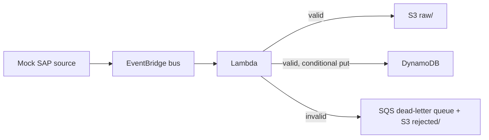

# sap-event-bridge

A pipeline for **mock** SAP business events on AWS: EventBridge, Lambda, DynamoDB, S3 and a
dead-letter queue. All data is synthetic. The point is the design: validation, idempotency,
failure handling and least-privilege infrastructure, checked by tests.



See [docs/ARCHITECTURE.md](docs/ARCHITECTURE.md) for the full flow and [docs/DECISIONS.md](docs/DECISIONS.md)
for why it is built this way.

## Run it locally (no AWS account needed)

```bash
pip install -e ".[dev]"
pytest                          # 62 tests
sapbridge demo                  # the whole pipeline on mocked AWS
sapbridge generate --n 3        # print mock events as JSON lines
```

Output of `sapbridge demo` (default seed, copied from a real run):

```
Sent 50 events, then re-sent 5 of them (simulated redelivery)
  processed    45
  duplicate     5   (detected, not stored twice)
  rejected      5   (invalid; archived and sent to the dead-letter queue)

DynamoDB items      45   (equals processed)
S3 raw/ objects     45
S3 rejected/         5
DLQ messages         5

Processed by type:
  sap.mock.GoodsReceipt.Posted        19
  sap.mock.PurchaseOrder.Changed      12
  sap.mock.PurchaseOrder.Created      14
```

The counts must add up, and the tests assert it for several seeds: processed plus rejected equals
the events sent, DynamoDB items equal processed, and every rejected event is both archived and
queued.

## What it does

- **Validates** every event strictly. Errors name the failing path, such as `$.data.po_id`.
- **Rejects without retrying.** Invalid events go to a dead-letter queue with the reason. Retrying
  bad data cannot fix it.
- **Is idempotent.** A redelivered event is detected by a conditional write and stored once.
- **Retries transient failures** and keeps events that exhaust their retries in a second queue.
- **Archives** every accepted event to S3 and keeps per-order history in DynamoDB.
- **Restricts permissions.** The Lambda role can only put an item, put an object and send a message,
  each on one resource.

## Deploying

```bash
mkdir -p build && zip -r build/sapbridge.zip sapbridge
aws s3 cp build/sapbridge.zip s3://<your-code-bucket>/sapbridge.zip
aws cloudformation deploy --template-file template.yaml --stack-name sap-event-bridge \
  --capabilities CAPABILITY_IAM \
  --parameter-overrides CodeBucket=<your-code-bucket> CodeKey=sapbridge.zip
```

The table and bucket are retained when the stack is deleted. Remove them by hand when finished.

## Status and limits

- **Not deployed to a real AWS account.** The template passes `cfn-lint`, and the handler is tested
  against moto, an in-process imitation of AWS. Real behaviour such as throttling, IAM evaluation and
  EventBridge retries has not been observed. Treat the first deployment as the real test.
- **The SAP side is a mock.** There is no connection to SAP. Events are generated by
  `sapbridge/mock_source.py` and labelled `sap-mock://`.
- **No authentication on the producer.** Anyone who can put events on the bus can send them.
  Restrict that with an EventBridge resource policy in a real setup.
- **No cost figures.** [docs/COST.md](docs/COST.md) lists the cost drivers only.
- **The DynamoDB item holds one event, not the current order state.** Current state would be derived
  from the history.

## Layout

```
sapbridge/
  events.py        envelope and strict validation
  mock_source.py   deterministic mock events, with deliberate bad ones
  handler.py       Pipeline and the Lambda entry point
  cli.py           generate and demo commands
template.yaml      CloudFormation stack
docs/              architecture, design decisions, cost drivers
tests/             62 tests
```

## License

MIT
