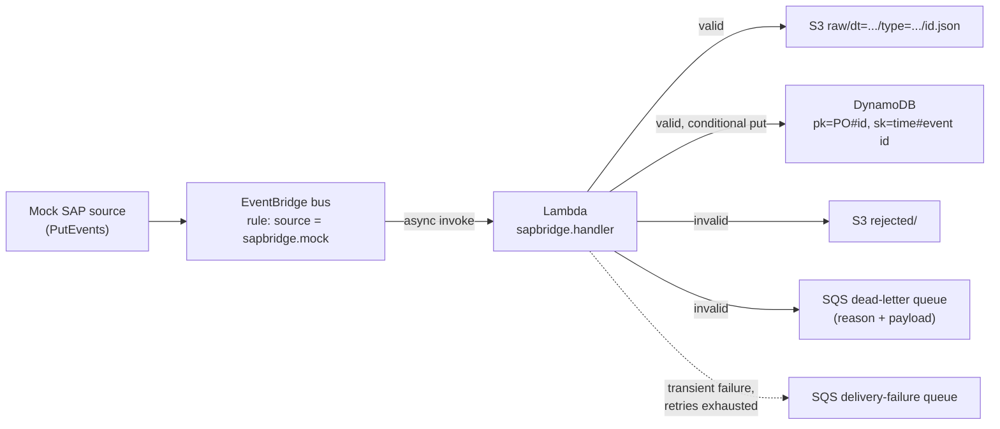

# Architecture

All events are **mock** data. The source is labelled `sap-mock://...` and the validator
refuses anything else, so mock events cannot be mistaken for real ones.

## Flow of one event

1. The producer sends a CloudEvent as the `detail` of an EventBridge `PutEvents` entry.
2. A rule on the custom bus matches `source = sapbridge.mock` and invokes the Lambda function.
3. The handler validates the event (`sapbridge/events.py`).
   - **Invalid:** archived under `rejected/`, sent to the dead-letter queue with the reason
     and the failing path, and the invocation succeeds so it is not retried.
   - **Valid:** archived under `raw/`, then written to DynamoDB with a conditional put.
4. If the conditional put finds the same entity and sort key, the event is a duplicate and
   nothing is stored again.
5. Transient AWS errors raise. Lambda retries twice, then sends the event to the
   delivery-failure queue.

## Data model

| Store | Key | Purpose |
|---|---|---|
| DynamoDB | `pk = PO#<po_id>`, `sk = <UTC time>#<event id>` | Event history per purchase order, read in time order with one query |
| S3 `raw/` | `dt=<date>/type=<type>/<id>.json` | Immutable copy of every accepted event |
| S3 `rejected/` | `dt=<date>/<sha256>.json` | Every rejected payload, expired after 90 days |

## Security choices

- Least-privilege IAM: the role can only `PutItem`, `PutObject` and `SendMessage`, each on one resource.
- Bucket blocks all public access and is encrypted. Queues are encrypted. DynamoDB uses
  point-in-time recovery.
- The table and bucket are retained when the stack is deleted, so deleting the stack does not
  delete data. Remove them by hand when you are done.
